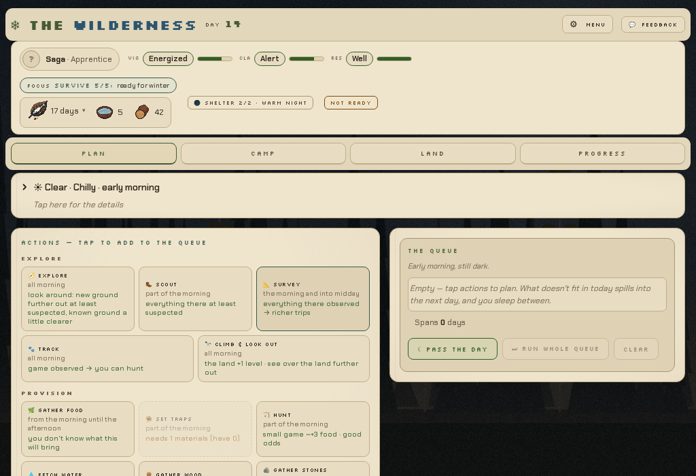
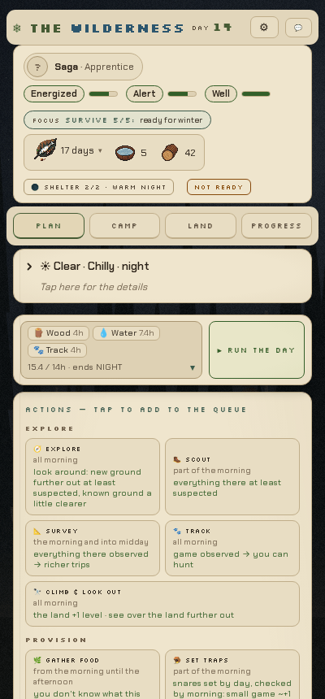
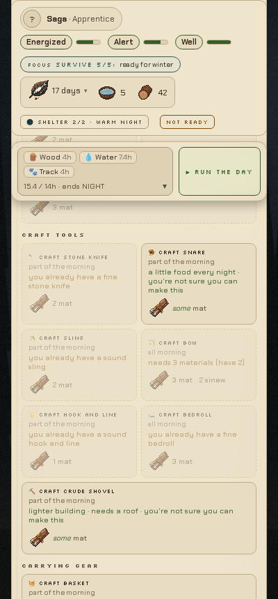
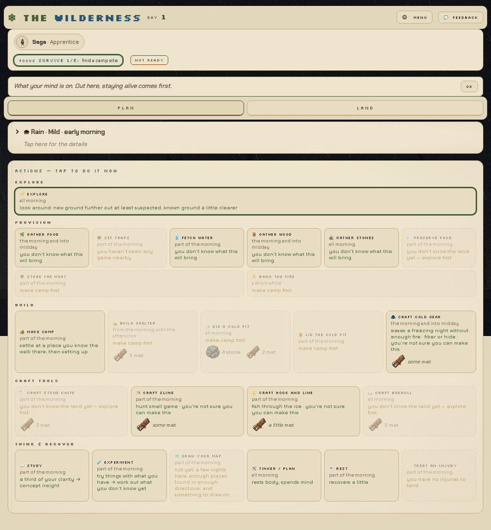
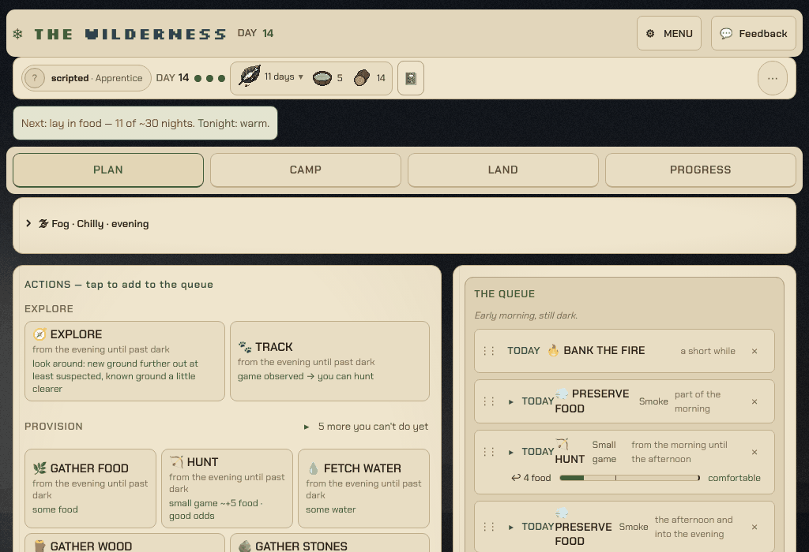
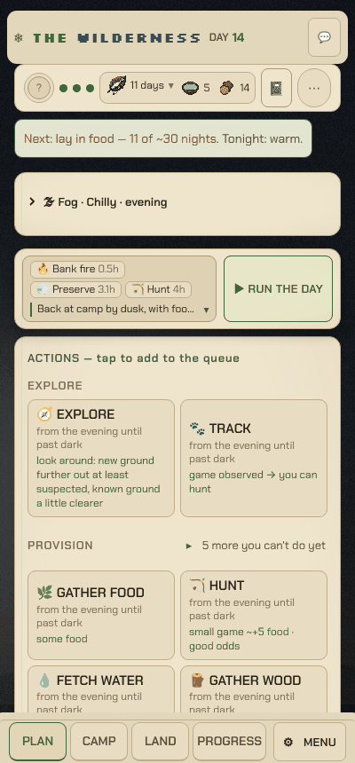
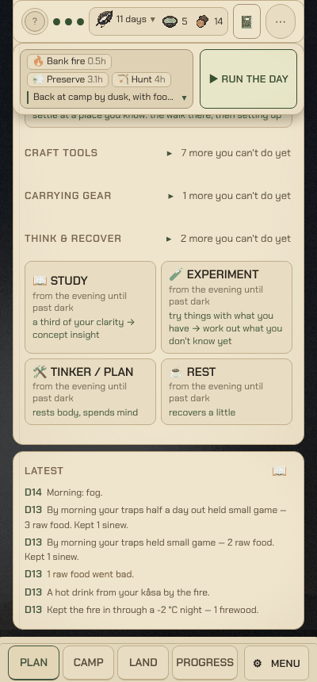
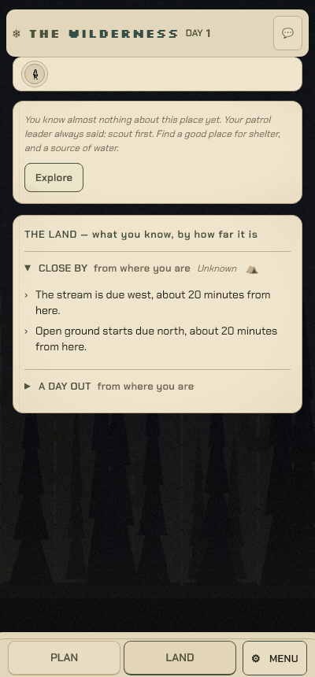

# Design analysis: the Artificer vs RuneScape and WalkScape (#1914)

**Date:** 2026-10-21
**Status:** analysis, for the owner. No behaviour change.
**Covers:** the Artificer (`src/artificer*`), with Core Warden and the shared hex world (#1873, `docs/spikes/artificer-hex-world.md`) where they matter; Old School RuneScape (OSRS) and RuneScape 3 (RS3); WalkScape.

The owner: "I feel that's where we are weakest. Not necessarily the mechanics themselves." So this doc is mostly about the UI and UX, on an Android tablet in landscape first and a phone second. The mechanics comparison is shorter (Part 2) and is there to explain UI choices.

Facts about the Artificer come from the code on `main` at this date and from screenshots of the built game (`npm run build:artificer`, served locally, Chromium at 1024 × 700 and 400 × 860 with touch on, a fresh game and a scripted mid-run save at day 14). Facts about the other games come from the sources at the end; each claim links to one. Where a source didn't give a number, this doc doesn't give one either.

---

## Summary

The Artificer's rules are deeper than RuneScape's or WalkScape's: a 14-hour day budget, a 60-day year, hidden skills, knowledge as progression. Its UI hasn't caught up. On a 1024 × 700 tablet, the first action card starts halfway down the screen. On a 400 px phone, a third of the screen stays frozen as chrome. Day 14 shows 34 action cards, 19 of them greyed out, and every action's name is set in an 8 px pixel font. The status bar has eight separate chips and boxes, and two of them disagree ("FOCUS 5/5: ready for winter" beside "NOT READY"). A new player goes through language, nine intro steps, a stat screen and a 56-item packing list before their first action. RuneScape's mobile clients and WalkScape solve the same problems with a few habits worth copying: a small number of things always visible, everything else one tap away; the main action always in the same place; big targets at the screen's edges; a clear "this will take N" before you commit; a short first session. The roadmap at the end of Part 1 puts the biggest wins first: readable type, a compact status line with tabs at the bottom, fewer cards, and one honest "where you stand" line. None of it needs a rules switch; all of it can go behind `kind: 'ui'` switches in `src/artificer/features.ts` so the owner can compare.

---

## At a glance

| Dimension | The Artificer | RuneScape mobile (OSRS / RS3) | WalkScape |
|---|---|---|---|
| **Platform and shape** | Web page; Android tablet in landscape first, phone supported (`style.css` breakpoints at 900 / 700 / 520 px) | Native app, held in landscape; plays with desktop players | Native phone app; full screens you swipe between |
| **Always on screen** | Title bar, sticky status bar (name, 3 vitals, FOCUS chip, key box, shelter chip, readiness chip) | Minimap, side panels at the edges, chat (collapsible) | One screen at a time: character, location, activity |
| **Main action** | Tap an action card (34 at day 14), pick its options, then "Run the day" | Tap the world; long-press or single-tap mode for the menu | Pick an activity at your location, then walk |
| **Text** | Pixel font (Silkscreen) 7–9 px for labels and action names; Chakra Petch 10–16 px for prose | Small UI text over a 3D world | Short labels, numbers (steps to go) |
| **Long actions** | Turn-based; a timer drawer plays the day (1×/2×/4×, skip, stop) | Real time; RS3 can push a phone notification when a ship returns | Steps apply when you open the app; spare steps bank |
| **First minutes** | Language, 9 intro steps (story, Warden, talents, stats, pack), a weather card, guide tips | Tutorial island (not covered here) | Spawn in a forest, pick an activity |
| **Core loop** | A 14-hour day of queued actions, then a night; a 60-day year | Click, repeat, bank; levels, quests | Walk; activities at locations |
| **Progression** | Hidden skills by practice hours; techniques; 34 concepts; the land | 24 skills (OSRS), 29 (RS3); exponential XP | Skills to 99; work efficiency |
| **Economy** | Village trade in marks; records and a weekly world | Grand Exchange, trading, ironman modes | One-on-one trades (Oct 2026), Ironfoot mode |
| **AI players** | First-class: API, MCP server, nightly bench | Bots break the rules | Not a feature |

---

# Part 1: UI and UX

## 1.1 How RuneScape does it on mobile

Both RuneScape clients came to phones years after the desktop game and had to fit a dense desktop UI onto a small landscape screen. Their solutions are a mix of collapsing things and moving them to the edges.

- **Panels at the edges, collapsible.** OSRS mobile's side panel ("Side Stones") is collapsible; since November 2024 its left column holds the menus you use in a hurry (inventory, gear, prayer, spellbook, combat) and its right column the relaxed ones (skills, music, settings) ([OSRS Mobile](https://oldschool.runescape.wiki/w/Old_School_RuneScape_Mobile)). RS3 mobile uses a ribbon on the right, and in May 2021 moved the minimap to the bottom right so the buttons around it are easier to reach holding the device in landscape ([RuneScape Mobile](https://runescape.wiki/w/RuneScape_Mobile)).
- **Hotkeys you choose.** OSRS has up to five customisable hotkeys that open any panel ([OSRS Mobile](https://oldschool.runescape.wiki/w/Old_School_RuneScape_Mobile)). RS3 lets you swap the left and right action bars ([RuneScape Mobile](https://runescape.wiki/w/RuneScape_Mobile)).
- **The chat shrinks.** OSRS's chatbox collapses; RS3's cycles hidden, minimised and maximised with one tap (both pages above).
- **Touch instead of right-click.** OSRS's single-tap mode does a desktop right-click; otherwise you touch and hold. "Tap to drop" turns the inventory red and drops what you tap. A deadzone setting moves side buttons away from the screen's edge ([OSRS Mobile](https://oldschool.runescape.wiki/w/Old_School_RuneScape_Mobile)). RS3 added a one-tap gameplay option in 2020 and shows the interaction menu beside your finger, not under it ([RuneScape Mobile](https://runescape.wiki/w/RuneScape_Mobile)).
- **Bigger slots where it matters.** RS3 gave the Beast of Burden inventory bigger slots on mobile in June 2021 ([RuneScape Mobile](https://runescape.wiki/w/RuneScape_Mobile)).
- **Notifications for long timers.** RS3 mobile sends a phone notification when a Player-owned Ports ship returns ([RuneScape Mobile](https://runescape.wiki/w/RuneScape_Mobile)). The OSRS page doesn't list idle notifications, and this doc doesn't claim one.
- **Small screen, but always the world.** The world view stays the centre; every panel is a layer over it. The 28-slot inventory grid ([OSRS Inventory](https://oldschool.runescape.wiki/w/Inventory)) is one of those layers.

What it adds up to: few things on screen at once, the rest one tap away, the edges for buttons, and settings that let players move things where their thumbs are.

## 1.2 How WalkScape does it

WalkScape is a phone app from the start, and its loop is built so you barely need the screen.

- **One screen at a time.** A horizontal menu swipes between Character, Location, Activity, Journal and Feed; a vertical menu holds Leaderboards, Crafting, Travel and Inventory. The Android back button or a long swipe from the left edge returns to the main view ([CBT Deep Dive #1](https://portal.walkscape.app/post/216)).
- **The activity screen says how long.** It shows the steps to the next level, and for a craft you choose how many to make and the game predicts the steps it will take (same source).
- **Unknown places are question marks.** Unvisited locations show as `?` on the map until you've been; afterwards you can read about them from anywhere (same source).
- **The inventory is a count.** A 28-slot soft cap with the count in the corner ("29/28"); going over costs efficiency, never all of it. Long-press opens multi-select for drop or bank ([CBT Deep Dive #2](https://portal.walkscape.app/post/221)). Chests go to a separate Treasury and take no space until opened (same source).
- **Check in when you like.** Steps apply when you open the app; the beta guide suggests a glance "every 1k–10k steps" ([CBT Deep Dive #1](https://portal.walkscape.app/post/216)). Activity queuing came later, in the June 2025 Travel +1 update ([roadmap](https://walkscape.app/roadmap)). Opt-in push notifications were planned by the developers in a Quality of Life update; whether they shipped isn't confirmed here.
- **Onboarding is the world.** You make a character and start in a small town or forest with a few activities: woodcutting, foraging, fishing, mining ([Daily Illuminator](https://www.sjgames.com/ill/archive/February_01_2025/Step_It_Up_With_WalkScape)).
- **Where it falls short.** A reviewer who uses a wheelchair could not play: only steps count, and there's no other input ([review](https://reviewsbysupersven.com/walkscape/)).

What it adds up to: each screen does one job, the main number (steps to go) is always the biggest thing on it, and the first session is seconds long.

## 1.3 The Artificer's UI today

The web frontend is plain DOM, no framework: every click updates the app state through the controller and `render()` redraws the page (`src/artificer-app/main.ts`, 2,757 lines; `controller.ts`). One stylesheet (`style.css`, 1,483 lines) and nine looks in three eras, scout, steampunk and rune (`looks.ts`). 13 ui switches and 47 rules switches (`features.ts`).

**What's on screen, top to bottom** (tablet, mid-run):

1. **Title bar:** the place ("THE WILDERNESS"), the day, ⚙ MENU, 💬 FEEDBACK.
2. **Status bar** (sticky, `.statusbar`): the Warden chip (name, rank; opens the Warden tab), three vitals as word chips with bars (VIG Energized, CLA Alert, RES Well), the FOCUS chip (`focus-popover.ts`; with the `guide` ui switch it shows the Survival path, `survival-path.ts`, "Survive 5/5: ready for winter"), the key box (`key-box.ts`: food as days, water, firewood), the night chip ("SHELTER 2/2 · WARM NIGHT") and the readiness tag ("NOT READY").
3. **Guide tips** (`guidetip` in `main.ts`): one line with an OK button, early on.
4. **Tabs:** PLAN, CAMP (once there's a camp), LAND, PROGRESS; HISTORY in dev mode (`APP_TABS` in `feature-choices.ts`). The Warden tab opens from the name chip.
5. **Weather row** (`weather-fold.ts`): "☀ Clear · Chilly · early morning", tap for details. On a new morning a weather card comes first and needs "Got it".
6. **PLAN:** the action cards in sections (Explore, Provision, Build, Craft tools, Carrying gear, Think & recover), each with its time ("all morning"), what it'll bring, and the cost in materials with item icons. Greyed cards say why ("make camp first", "needs 4 stone (have 0)"). Tapping a card opens its options inline (which way, how far: `directed-explore`, `action-length`).
7. **The queue** (`plan-layout.ts`, ui switch `side-queue`): beside the actions on a tablet, frozen while the actions scroll; a frozen strip over them on a phone. Each item shows its yield and load ("8 fuel, 2 mat", "heavy, but camp is close"); drag to reorder (`queue-drag.ts`). "Run the day", "Run whole queue", "Clear".
8. **The timer drawer** (`.timer`, `time-view.ts`): plays the day from the bottom of the screen, with 1×/2×/4×, Skip and Stop (`stop-action`).
9. **Latest** (the journal's last lines) in a box below the plan; the full journal is on PROGRESS.

Before planning is learned (#1350), PLAN says "tap to do it now" and each action runs at once. The other tabs: **CAMP** (`camp-blocks.ts`, `camp-view.ts`: vitals as numbers, stores with icons, cold storage, tools with grades, concepts, site and shelter cards), **LAND** (`land-view.ts`, `map-view.ts`: the drawn text map of the Reach once you've drawn it, and the land in words by distance), **PROGRESS** (`progress-view.ts`: the season, the winter outlook bars, key stores, milestones, the journal). The ⚙ MENU (`meny.ts`) holds new game, the weekly world, records, language, the guide, looks and switches. `?dev` (password-gated, `feature-choices.ts` `devMode`) adds the dev panel and HISTORY.

**On a phone** (400 × 860), the same page stacks into one column:

**What it does well,** and should keep:
- **Words, not numbers.** Vitals say "Energized", the pack screen says "It's filling up", the land says "Birch wood starts north-west, about an hour". This is the game's voice and its best UI idea.
- **Greyed cards explain themselves.** "Needs 3 materials (have 2)" teaches the rules in place.
- **The queue shows consequences.** Yield, load and "This runs past dark" before you commit.
- **Care in the details.** Safe-area insets, `prefers-reduced-motion` everywhere, Swedish and English, sticky queue column, a phone strip that unfolds, a drawer timer you can stop.

## 1.4 Where it falls short

Each finding is measured from the screenshots or the code.

**F1. Half the screen is chrome before the first action.**
- Tablet, 1024 × 700, day 14: the first action card starts at about y = 395. The title, status bar, tabs and weather row take the top 320 px; the actions section header takes the next 70.
- Phone, 400 × 860: the first card starts at about y = 540.
- Scrolling, the status bar stays: about 137 px of the tablet's 700 (20%), and on the phone the status bar (about 195 px) plus the queue strip (about 90 px) stay frozen, a third of the screen.

RuneScape keeps the world in the middle and puts panels at the edges; WalkScape gives each screen one job. The Artificer stacks everything at the top.

**F2. Too many cards, too many of them greyed.**
- Day 1: 24 action cards, 11 greyed. Day 14: 34 cards, 19 greyed.
- The PLAN page is 2,223 px tall on the tablet and 2,682 px on the phone: three to four screens of scrolling for one choice.
- Greyed cards are useful once ("make camp first"), but most of the page is now things you can't do. The guide highlights one suggestion (`guide-suggest`), and it's lost among 33 others.

**F3. The most important words are the smallest.**
- Every action's name ("GATHER WOOD") is Silkscreen at 8 px (`.act .t` in `style.css`). Tabs are 9 px, vital labels 7 px, the status tags 8 px, milestone names 8 px. (The timer's speed buttons are the good exception: 10 px text on 44 × 40 px targets.) Letter-spaced caps in a pixel font read slowly at any size, and at 7–9 px they're hard on a tablet at arm's length.
- Meanwhile the action's *time* ("all morning") and *result* are in the larger, readable Chakra Petch. The eye lands on the wrong line.
- RuneScape's text is small too, but it labels a picture; in a text game the text *is* the picture.

**F4. Chips that disagree.**
- The status bar has eight separate items. At day 14 the FOCUS chip says "Survive 5/5: ready for winter", which reads as done; beside it the tag says "NOT READY"; PROGRESS says food is "falling short" (17 of ~30 nights). The chip means "step 5 of 5 is the one you're on", but nothing says so.
- The key box's food reads "17 days" with a ▾; the night chip says "SHELTER 2/2 · WARM NIGHT". Each is clear alone; together they're a dashboard to decode.

**F5. Small targets in hard places.**
Measured on the phone with touch on, against Android's recommended 48 × 48 dp ([Android accessibility](https://developer.android.com/guide/topics/ui/accessibility/apps)) and WCAG 2.2's 24 × 24 px minimum ([WCAG 2.5.8](https://www.w3.org/WAI/WCAG22/Understanding/target-size-minimum.html)):

| Target | Size (px) |
|---|---|
| ⚙ MENU (phone) | 35 × 27 |
| 💬 Feedback (phone) | 33 × 24 |
| Weather row (opens details) | 338 × 21 |
| FOCUS chip | 231 × 23 |
| Guide tip OK | 36 × 24 |
| Intro SKIP | 57 × 24 |
| Tabs (phone) | 88 × 32 |
| Action cards | 166 × 69 to 166 × 130 (fine) |

The tabs and menu sit at the top of the screen, the farthest point from a thumb on a phone and from both thumbs on a tablet held in landscape. RS3 moved its minimap to the bottom right for exactly this reason ([RuneScape Mobile](https://runescape.wiki/w/RuneScape_Mobile)).

**F6. The first five minutes are forms.**
In order: choose a language; a story beat; "Who are you?" (name, up to 2 of 4 talents with a "difficulty ×2.10" readout, age 11–14, six stats with ± buttons and point costs); "What will you pack?" (56 items in six groups, each with inside/strapped-on choices, a weight bar and straps count); four more story beats; "Survive. Thrive."; then the land; then a weather card to dismiss; then guide tips with OK buttons. Everything is skippable and sensibly pre-filled ("ticked for you"), but nothing says so up front, and it's several minutes before the first real choice. WalkScape starts you in a forest with an activity to pick ([Daily Illuminator](https://www.sjgames.com/ill/archive/February_01_2025/Step_It_Up_With_WalkScape)).

**F7. The game's voice is at the bottom.**
The journal is where the Artificer is best ("A thicket heavy with late berries, untouched — the birds haven't found it yet"). On PLAN it's the "Latest" box after all the cards: about 1,800 px down on the tablet and 2,400 px on the phone. The timer drawer shows lines while the day plays, then they're gone from view. A day's result, the thing the player waited for, has no moment of its own.

**F8. How long things feel.**
The timer drawer is good, and Skip and 4× respect the player's time. But before running, the queue says "15.4 / 14h · ends NIGHT" and per-item yields; it doesn't say where you'll *be* at dusk (tired? back at camp? with enough wood?). WalkScape's "this craft will take 1,240 steps" is the model: one number, the biggest on the screen.

**F9. Many ways to change the look, few to simplify it.**
Nine looks, 13 ui switches, a feedback panel and a password-gated dev mode. Useful for building the game. But there's no "simple" view: no way to hide greyed cards, shrink the status bar or put tabs within reach.

## 1.5 What to copy for the UI

1. **A few things always, the rest one tap away** (RuneScape's collapsible panels). The status bar becomes one line: vitals as three small word-dots, food/water/wood, the day. FOCUS, shelter and readiness go into one "where you stand" line or behind a tap.
2. **Controls where thumbs are** (RS3's minimap move, OSRS's deadzone). Tabs at the bottom on a phone; on a landscape tablet, the run button and tabs at the bottom corners.
3. **One screen, one job** (WalkScape). PLAN shows what you can do now; what you can't goes into a fold per section ("4 more you can't do yet").
4. **The cost before you commit, as the biggest number** (WalkScape's predicted steps). The queue's footer says, in words, where the day ends.
5. **Bigger targets where it matters** (RS3's bigger Beast of Burden slots). Everything tappable at least 44–48 px tall on touch.
6. **Start in the world** (WalkScape). Defaults for the Warden and the pack, a "change" link, and the first choice within a minute.
7. **A moment for results.** RuneScape and WalkScape celebrate a level or a chest; the Artificer's equivalent is the day's outcome. Give it a card.
8. **Don't add notifications.** RS3 notifies for a ship because time runs while you're away ([RuneScape Mobile](https://runescape.wiki/w/RuneScape_Mobile)). The Artificer waits for you; nothing needs to call you back. A weekly-world reminder is the one exception worth considering, and it's off-device (email) or opt-in.

## 1.6 UI roadmap, in priority order

Sizes are the house T-shirt sizes (XS = 1 … XL = 8). All of these are presentation only: no sim, save, RNG or AI change, so none needs a rules switch. Each can sit behind its own `kind: 'ui'` switch in `src/artificer/features.ts`, read with `uiFeatureOn`, so the owner can compare old and new and the switches can be retired once settled. All are exempt from ATDD (`ui-hud` / `ui-menus`): acceptance is screenshots at 1024 × 700 and 400 × 860, in both languages and at least two looks.

| # | Item | Size | Fixes | Touches | Switch |
|---|---|---|---|---|---|
| 1 | **Readable type.** Action names, tabs, tags, vital labels and milestones in the body font at 14–16 px (12 px minimum anywhere); Silkscreen only for headings of 16 px and up; no letter-spaced caps under 12 px. | M | F3 | `style.css` (`.act .t`, `.tabbtn`, `.mini .ml`, `.statusbar .tag`, `.phase`, `.miles li .mn`), `looks.ts` (per-look font vars) | ui `readable-type` |
| 2 | **Compact status, tabs at the bottom.** One-line status bar (day, three vitals as word-dots, food/water/wood); everything else on tap. Tabs as a bottom bar under 900 px, with ⚙ in it; frozen chrome no more than ~15% of the viewport on any size. | L | F1, F5 | `main.ts` (status bar and tab render), `key-box.ts`, `focus-popover.ts`, `feature-choices.ts` (`APP_TABS`), `plan-layout.ts` (strip offset `--stick-top`), `style.css` | ui `compact-status` |
| 3 | **Fewer cards.** Show what you can do now; fold the rest per section ("4 more you can't do yet", each with its reason inside); the guide's suggestion first and larger. | M | F2 | `main.ts` (action grid), `plan-layout.ts`, `survival-path.ts`, `action-visibility` stays the rules layer | ui `fewer-cards` |
| 4 | **One "where you stand" line.** Merge the FOCUS path, readiness tag and night chip into one sentence: "Next: lay in food — 17 of ~30 nights. Tonight: warm." Fix "5/5: ready for winter" reading as done. | S | F4 | `survival-path.ts`, `key-box.ts` (`nightChip`), `progress-view.ts` (`outlookWarnings`), `main.ts`, i18n keys in `src/artificer/i18n` | under `guide` (existing ui switch) or ui `standing-line` |
| 5 | **Touch targets.** Under `(pointer: coarse)`, every button at least 44 px tall with 8 px between neighbours: ⚙, feedback, weather row, FOCUS chip, guide OK, SKIP, queue ✕, intro dots. | S | F5 | `style.css` only | none needed (a fix); or ui `touch-targets` to compare |
| 6 | **A quick start.** After language: one story beat, then "You're Saga, 12, a scout. Your pack is ready." with Play and "Change who I am / what I packed". The pack and stat screens stay, one tap away. First choice within about a minute. | M | F6 | `intro.ts`, `opening-view.ts`, `main.ts` (intro flow), `kit.ts` `suggestedPack` (read only), `stats.ts` `DEFAULT_STATS` (read only) | ui `quick-start` (rules unchanged: `stats-before-pack` still decides the order when you do open them) |
| 7 | **The day's result as a card.** When the day ends, a short card: what you brought back, what the night took (food eaten, wood burnt, anything spoiled or stolen), tomorrow's sky. The journal one tap from the status bar instead of at the page's foot. | M | F7 | `time-view.ts`, `journal-view.ts`, `explore-finds.ts`, `main.ts` (timer end), `key-metrics.ts` (read only) | ui `day-card` |
| 8 | **Say where the day ends.** The queue's footer in words: "Back by dusk, tired, with wood for three nights." Same on the phone strip. | S | F8 | `forecasts.ts`, `plan-layout.ts` (`queueStrip`), `queue-words.ts` | ui `day-forecast` (the AI's text in `observe.ts` unchanged) |
| 9 | **Use the tablet's width.** At 1000 px and up, the journal's latest lines live in the sticky side column under the queue, so a landscape tablet shows choice, plan and result on one screen. | S | F7 | `plan-layout.ts`, `style.css` (`.plan.sideq` grid) | extend `side-queue` |
| 10 | **A simple view.** A ⚙ toggle that turns on 1–4 at once for players who want less, and is the default for new players once they've settled. | XS | F9 | `meny.ts`, `feature-choices.ts` | ui `simple-view` (groups the others) |

Do 1, 2 and 5 first: together they change how every screen feels on a tablet and a phone, and they're CSS and layout work with no game logic. Then 3 and 4, which change what the player reads first. 6 and 7 change the first session and the rhythm of a day, and are worth a playtest each.

## 1.7 Re-measured after the roadmap (#1997)

Items 1–9 shipped between 22 and 28 October, each behind its own ui switch, all on by default:
- readable type (#1923) and the compact status with tabs at the bottom (#1924);
- fewer cards (#1925, #1965) and the "where you stand" line (#1926);
- touch targets (#1927) and the quick start (#1928);
- the day card (#1929), where the day ends (#1930) and the tablet's width (#1931).

They were built and checked one at a time. On 29 October they were measured together, the way §1.4 measured the UI before them.

**How it was measured:** `scripts/artificer-ui-measure.mjs`, at 1024 × 700 and 400 × 860, in English and Swedish, with touch on. It needs the built site served (`npm run build`, then `npm run preview`).
- **Day 1:** a new game from a cleared page, tapping through to the first real choice.
- **Day 14:** the nightly playtest's scripted Warden on the morning of day 14, with its plan for the day queued (`scripts/artificer-ui-saves.ts`). The page is set up as a returning player sees it: through the first-morning guide, with the weather box opened once before.
- **Languages:** Swedish lays out like English, with pages up to 30 px shorter or longer, so the numbers below are English.
- **Comparability:** §1.4's day 14 was a different game, so the two pages show different cards, but the layout is the same.

| Finding | Before (§1.4) | Now | Verdict |
|---|---|---|---|
| **F1** first card, tablet | y ≈ 395 | y = 407 | no better |
| F1 first card, phone | y ≈ 540 | y = 450 | better |
| F1 frozen when scrolled, tablet | 137 px (20%) | 54 px (8%): the status line, with the queue's own column beside it | fixed |
| F1 frozen when scrolled, phone | ≈ 285 px (33%) | 194 px (23%): status line 54, queue strip 91, tab bar 49 | better; §1.6 aimed for ~15% |
| **F2** cards, day 1 | 24, 11 greyed | 13, none greyed (Explore's chooser open) | fixed |
| F2 cards, day 14 | 34, 19 greyed | 12, none greyed; 19 more folded into five "N more you can't do yet" lines | fixed |
| F2 PLAN height, day 14 | 2,223 px tablet, 2,682 px phone | 1,295 px, 1,739 px | fixed |
| **F3** smallest type | 7–9 px Silkscreen | 12 px Chakra Petch; no pixel font under 16 px on the screens measured | fixed |
| **F4** chips | eight items, two disagreeing | the status line (Warden, day, three dots, food, water and wood, 📓, ⋯) and one line, "Next: lay in food — 11 of ~30 nights. Tonight: warm.", which agrees with the key box and the queue (both 11) | fixed, with one new mismatch (below) |
| **F5** the targets §1.4 listed | 21–32 px tall | all 44 px tall: ⚙ 82 × 44, 💬 108 × 44 (37 × 44 on a phone), weather row 962 × 44, "where you stand" 336 × 44, tabs 242 × 44 (65 × 44, at the bottom, on a phone) | fixed |
| F5 every other target | not measured | 15 under 44 px tall on the tablet's day 14 (below) | short |
| **F6** to the first real choice | language, nine intro steps, a stat screen, a 56-item packing list, four more story beats… | four taps: the language, one story screen, "You're Saga, 12, a scout. Your pack is ready." ▸ PLAY, then Explore on LAND; the first morning's weather card ("Got it") comes before the chooser | fixed |
| **F7** the journal | ≈ 1,800 px down on a tablet, 2,400 on a phone | under the queue in the tablet's side column; 1,463 px down on a phone; 📓 opens it from any tab, and a card ends each day | fixed |
| **F8** before Run | "15.4 / 14h · ends NIGHT" | "Back at camp by dusk, with food for 11 nights." over Run | fixed |
| **F9** a simple view | none | every switch is on by default, so #1932 has nothing left to turn on | moot |

 

### What's still short

1. **The tablet's top (F1, #1998).** The first card starts at y = 407 of 700, about where it did before. The compact status line saved space, but the "where you stand" line and the 44 px tabs and weather row took it back.
   - Five full-width rows stack before the actions box: the title (y 20–64), the status line (72–126), "where you stand" (134–178), the tabs (194–238) and the weather row (250–322).
   - The title bar and the status line both say "DAY 14".
   - Room to win: one top row (title, menu and status together), the "where you stand" line beside the status on wide screens, and the weather row folded into the tab row.
2. **Touch targets the first pass missed (F5, #1999).** The 15 targets under 44 px tall on the tablet's day 14:
   - **The main buttons:** ▶ RUN THE DAY 129 × 37, RUN WHOLE QUEUE 168 × 37 and CLEAR, all 37 tall (and day 1's Explore, 75 × 37).
   - **The queue's rows:** the ▸ that unfolds a row is 10 × 14, under WCAG's 24 × 24 floor; the drag grips are 30 × 25.
   - **Elsewhere:** the Warden chip is 165 × 34 (34 × 34 on a phone); the key box's food is 84 × 32 (77 × 25 on a phone); the journal's 📖 is 33 × 32; LAND's distance folds are 40 tall.
3. **The weather row says the wrong time (F4, #2000).** It shows the part of the day the plan *ends* in ("Fog · Chilly · evening"), the old TODAY chip's text. The queue under it says "Early morning, still dark." Now that the queue's own line says where the day ends, the row should say the time now.
4. **The phone's frozen chrome is still 23% (F1, #2001).** The status line, the queue strip and the tab bar stay on screen together. The strip is the biggest part, at 91 px.

The nine switches are all on by default. Once the owner has played with them and settled, they can be retired: their off paths and tests deleted, as §1.6 planned. That's the owner's call.

---

# Part 2: Mechanics, briefly

Where the mechanics explain a UI choice, it's said.

## 2.1 Core loop

- **RuneScape:** click a resource or monster, repeat until the 28-slot inventory is full, bank ([OSRS Inventory](https://oldschool.runescape.wiki/w/Inventory)). Many activities need little attention; the wiki calls this AFK training ([OSRS Idle](https://oldschool.runescape.wiki/w/Idle)).
- **WalkScape:** pick an activity at your location; each real step adds work to the current action ([CBT Deep Dive #1](https://portal.walkscape.app/post/216)).
- **The Artificer:** a 14-hour day (`DAY_HOURS`, `region1.ts`) of queued actions that spill into tomorrow; then the night settles it: one meal (`FOOD_PER_NIGHT`, `key-metrics.ts`), fuel (`nightFuel`), spoilage (`nightSpoilage`), scavengers (`camp-scavengers.ts`), healing. A 60-day year: snow on day 31, thaw on day 61 (`DEFAULT_CALENDAR`, `winter.ts`), then the caravan road (`road.ts`). A new Warden can't plan until a skill first rises (`canPlan`, #1350).

**Why it matters for the UI:** the Artificer's unit of play is a *day*, not a click. RuneScape and WalkScape can show one activity at a time because the player only ever does one. The Artificer has to show a plan, its cost and its result, which is why the queue and a day-result card (roadmap 7, 8) matter more than more cards.

## 2.2 Progression

- **RuneScape:** each level needs about 10% more XP than the last; 99 needs 13,034,431 XP; level 92 is about half of that; XP caps at 200 million ([OSRS Experience](https://oldschool.runescape.wiki/w/Experience)). OSRS has 24 skills, Sailing the newest (November 2025) ([OSRS Skills](https://oldschool.runescape.wiki/w/Skills)); RS3 has 29, with caps of 99, 110 or 120 ([RS3 Skills](https://runescape.wiki/w/Skills)). Quests gate areas and items: 184 in OSRS ([OSRS Quests](https://oldschool.runescape.wiki/w/Quests)).
- **WalkScape:** skills to 99; each level above an activity's requirement adds 1.25% work efficiency, up to 25%; toolbelt slots grow with a character level from lifetime steps ([CBT Deep Dive #2](https://portal.walkscape.app/post/221)).
- **The Artificer:** nine skills by practice hours (5 to Novice, 10,000 to Professional, a million at the top; `LEVEL_HOURS`, `skills.ts`), never shown: the player sees a Dunning–Kruger self-assessment (`perceivedLevel`) and journal lines ("The axe finds the grain more easily now"). Techniques (`techniques.ts`), 34 concepts (`content/concepts.json`), recipes discovered by doing (`DISCOVERIES`), focus at 4 Clarity a night (`focus.ts`), stats, and knowledge of the land (`exploration.ts`).

**Why it matters for the UI:** with no XP bar, progress has to be *felt*. Today it's felt in journal lines the player may not see (F7). Moving results to a card and the journal within reach is how hidden skills become visible without numbers.

## 2.3 Travel and the map

- **RuneScape:** a hand-made world; walking, run energy, Agility shortcuts, teleports, fairy rings, unlocked by quests and skills ([OSRS Transportation](https://oldschool.runescape.wiki/w/Transportation)).
- **WalkScape:** travel paid in steps, node by node, across 10 regions; unknown places are `?` ([CBT Deep Dive #1](https://portal.walkscape.app/post/216)). Agility and gear make travel cheaper; a double action while travelling jumps two nodes ([CBT Deep Dive #2](https://portal.walkscape.app/post/221)).
- **The Artificer:** walking hours from the day. Rings at +0/+3/+6 h (`exploration.ts`); a generated 48 × 32-cell Reach, a cell about half an hour on open ground (`world/reach.ts`); head out in 8 directions for 2/5/8 h (`directed-explore.ts`); trips walk real squares (`walk-the-map.ts`); you draw the map after 4 nights, 4 places in 3 directions (`map-learning.ts`). Next, hexes about a day's walk across (#1873).

**Why it matters for the UI:** the LAND tab's text map is a 48 × 32 grid of dots and letters at body size; on a phone it's the one view that would gain most from pinch-zoom or a "around me" crop. The hex world will make this bigger: the spike's "Further off" lines in words are the right first view.

## 2.4 Crafting, materials and carrying

- **RuneScape:** long chains (ore → bar → item) at stations; bank of up to 1,410 slots ([OSRS Bank](https://oldschool.runescape.wiki/w/Bank)). Wintertodt is a skilling boss where a warmth meter is your health and warm clothing cuts the cold ([OSRS Wintertodt](https://oldschool.runescape.wiki/w/Wintertodt)).
- **WalkScape:** gather at rural places, process at forge, kitchen, sawmill and workshop with tiers ([CBT Deep Dive #1](https://portal.walkscape.app/post/216)); 28-slot soft cap with a growing penalty, down to −99% at 33/28 ([CBT Deep Dive #2](https://portal.walkscape.app/post/221)).
- **The Artificer:** seven stores, grades crude → masterwork (`crafting.ts`), spoilage by temperature (`spoilRate`), cold pit 8 (12 at the river). A ~9 kg, 45-litre pack chosen before the run (`kit.ts`, `PACK_LITRES`); loads by weight and bulk against `maxLoad = 40 + 3 × (STR − 10)` (`load.ts`), with basket, backpack, harness and sled.

**Why it matters for the UI:** the Artificer's carrying is already smoother than WalkScape's cap; what WalkScape does better is *show* it as one count. The CAMP tab's stores and the queue's "heavy, but camp is close" are good; the craft cards repeat the material cost on every card, greyed, which is part of F2.

## 2.5 Social and economy

- **RuneScape:** the Grand Exchange with buy limits and a 2% tax since May 2025 ([OSRS Grand Exchange](https://oldschool.runescape.wiki/w/Grand_Exchange)); bonds turn money into gold and membership ([OSRS bond](https://oldschool.runescape.wiki/w/Old_school_bond)); ironman modes opt out ([OSRS Ironman Mode](https://oldschool.runescape.wiki/w/Ironman_Mode)); content passes at 70% of a poll ([OSRS Polls](https://oldschool.runescape.wiki/w/Polls)).
- **WalkScape:** one-on-one trades from 7 October 2026, up to 6 items plus money, no market yet; beta players start as "Ironfoot" and give it up to trade ([DevBlog #93](https://portal.walkscape.app/post/1920)). In the first days 483 players made 1,390 trades, 301 of them gifts ([DevBlog #94](https://portal.walkscape.app/post/1922)).
- **The Artificer:** single player; trade with village people in marks (`trade.ts`), trust, asks and free questions (`road.ts`, `villages.ts`); other players meet through run records, achievements by percentile and the weekly world (`records.ts`, `achievements.ts`, `weekly.ts`).

## 2.6 Pacing, sessions and stakes

- **RuneScape:** real time; OSRS logs you out after 5 idle minutes and always after 6 hours ([OSRS Idle](https://oldschool.runescape.wiki/w/Idle)). Hardcore Ironman has one life ([OSRS Ironman Mode](https://oldschool.runescape.wiki/w/Ironman_Mode)).
- **WalkScape:** steps bank while the app is closed; little failure ("progress never drops to 0%") ([CBT Deep Dive #2](https://portal.walkscape.app/post/221)).
- **The Artificer:** turn-based; the web game saves in the browser (`SAVE_KEY` in `controller.ts`). The playtime estimate (`src/artificer-ai/playtime.ts`) guesses a typical day at 20 s to look over plus 8 s an action, and says itself these are guesses. Death or collapse ends the Warden; the next inherits their tools as heirlooms (`legacy.ts`, #1455).

**Why it matters for the UI:** a turn-based game that waits suits a tablet you put down; the UI should make each day a short, complete chunk with a clear stopping point (the day card, roadmap 7). High stakes need warnings *before* they bite: the status line (roadmap 4) is where "food runs out in 3 nights" belongs.

## 2.7 AI players

RuneScape bans bots; WalkScape has none. The Artificer treats AIs as players: the play API (`src/artificer-play/api.ts`), the MCP server (`mcp.ts`), the nightly bench and records by model (`src/artificer-ai/`), the same moves as a person (`decision.ts`).

**Why it matters for the UI:** the AI reads `observe.ts` text, not the page, so every UI change in Part 1 leaves the AIs' game alone. The one thing to protect: keep the words the page shows and the words the AI reads saying the same thing (the guide is already app-only, `survival-path.ts`).

---

## What to borrow (mechanics)

Each names a follow-up, the files it touches, and whether it changes play (and so needs a rules switch in `src/artificer/features.ts`).

1. **Leagues-style rule mixes for the weekly world.** OSRS Leagues are fresh, time-limited worlds with their own rules ([OSRS Leagues](https://oldschool.runescape.wiki/w/Leagues)). The week's world also names a set of existing switches. Touches `weekly.ts`, `features.ts` `ruleFeatures`, `api.ts` `GET /api/v1/weekly`. **No new switch.**
2. **A goal ladder across Wardens** (quests, diaries, capes). "Warden's deeds" per region, on PROGRESS and the Records page. Touches `readiness.ts`, `achievements.ts`, `legacy.ts`, `progress-view.ts`. **No switch** while it only records; **a switch** if a deed ever rewards in play.
3. **Trails: travel gets cheaper where you've walked** (shortcuts, travel efficiency). A cell walked often costs less to cross. Touches `walk-the-map.ts`, `world/reach.ts` `walkFrom`/`COST`, `exploration.ts`, the save. **Rules switch** `trails`.
4. **Stations at camp** (WalkScape's services with tiers). A drying rack or smoking frame that `preserve` needs or does better at; uses `CraftRecipe.station`. Touches `camp-builds.ts`, `crafting.ts`, `region1.ts`. **Rules switch** `camp-stations`.
5. **Fine materials** (WalkScape's fine finds). A detailed patch sometimes gives fine inputs that raise a craft's grade. Touches `exploration.ts`, `crafting.ts` `craftScore`, its own `streamFor` stream. **Rules switch**.
6. **Publish how each switch plays** (the honest half of polls). Survival and grade with and without each rules switch, on the dev site. Touches `records.ts`, `dev/src/pages/artificer.astro`. **No switch.**
7. **Challenge badges** (Ironman, Ironfoot). Read from a finished run: no road trade, an empty pack, no heirlooms. Touches `records.ts`, `record-of.ts`. **No switch.**

## What to avoid

1. **Real-time pressure and offline decay.** A survival game that runs while you're away punishes having a life. Keep the Artificer waiting for you.
2. **A market money or bots can reach.** RuneScape's Exchange needs limits, a tax and a sink ([OSRS Grand Exchange](https://oldschool.runescape.wiki/w/Grand_Exchange)); RS3's Treasure Hunter sold XP and prizes, was called gambling, and was removed on 19 January 2026 ([RS3 Treasure Hunter](https://runescape.wiki/w/Treasure_Hunter)). With AIs as players, an open market would be farmed in a night.
3. **A visible grind.** No XP bars, level-up pop-ups or levels in the API view: the hidden-skill design is the point. The day card and the goal ladder give the "next goal" without the number.
4. **A dashboard UI.** RuneScape can afford many panels because the world is the picture. The Artificer's picture is its words; every chip added to the status bar takes attention from them.
5. **One kind of input for everyone.** WalkScape's step-only input left a wheelchair user out ([review](https://reviewsbysupersven.com/walkscape/)). Any future real-world input needs another way in.

---

## Open questions for the owner

1. **Tablet or phone first for the next UI pass?** The roadmap assumes a landscape tablet first. If phones are the real audience, item 2 (bottom tabs, compact status) moves above item 1.
2. **How much chrome is too much?** Is "frozen parts no more than ~15% of the screen" the right rule, or should the status bar scroll away entirely and come back on a tap?
3. **Should the pixel font stay for anything under 16 px?** It's the game's look; readable type (item 1) keeps it for headings only.
4. **Defaults for a new Warden:** may a new player start without seeing the stat and pack screens (item 6), or is choosing them part of the game?
5. **How long should a run be?** The playtime estimate is a guess. One evening, or a week of evenings, changes how much the day card and the goal ladder need to carry.
6. **What comes after Mistheim?** Many Wardens with one family of heirlooms, or one Warden for years in the hex world?
7. **Should levels ever be visible,** for example after a Warden dies, as their life's record?
8. **Will players meet each other?** Trades or letters between Wardens (people or AIs) would change the economy; WalkScape's one-on-one start is the safe shape.
9. **Monetisation stance.** If the Artificer is ever sold, write "never sell progress" down now.

---

## Sources

The Artificer (this repository, `main`, 2026-10-21), and screenshots of `npm run build:artificer` at 1024 × 700 and 400 × 860:
- UI: `src/artificer-app/main.ts`, `controller.ts`, `style.css`, `plan-layout.ts`, `key-box.ts`, `focus-popover.ts`, `survival-path.ts`, `feature-choices.ts`, `meny.ts`, `looks.ts`, `time-view.ts`, `journal-view.ts`, `land-view.ts`, `map-view.ts`, `camp-blocks.ts`, `progress-view.ts`, `intro.ts`, `opening-view.ts`
- Sim: `src/artificer/region1.ts`, `winter.ts`, `skills.ts`, `techniques.ts`, `focus.ts`, `content/concepts.json`, `exploration.ts`, `directed-explore.ts`, `walk-the-map.ts`, `map-learning.ts`, `world/reach.ts`, `kit.ts`, `load.ts`, `trade.ts`, `road.ts`, `camp-scavengers.ts`, `legacy.ts`, `key-metrics.ts`, `features.ts`
- Play and AI: `src/artificer-play/api.ts`, `mcp.ts`, `weekly.ts`, `achievements.ts`; `src/artificer-ai/playtime.ts`, `decision.ts`
- `docs/region-1-design.md`, `docs/spikes/artificer-hex-world.md`, `dev/src/pages/artificer.astro`

RuneScape:
- OSRS Wiki, [Old School RuneScape Mobile](https://oldschool.runescape.wiki/w/Old_School_RuneScape_Mobile)
- RuneScape Wiki, [RuneScape Mobile](https://runescape.wiki/w/RuneScape_Mobile)
- OSRS Wiki, [Experience](https://oldschool.runescape.wiki/w/Experience), [Skills](https://oldschool.runescape.wiki/w/Skills), [Quests](https://oldschool.runescape.wiki/w/Quests), [Grand Exchange](https://oldschool.runescape.wiki/w/Grand_Exchange), [Old school bond](https://oldschool.runescape.wiki/w/Old_school_bond), [Ironman Mode](https://oldschool.runescape.wiki/w/Ironman_Mode), [Idle](https://oldschool.runescape.wiki/w/Idle), [Transportation](https://oldschool.runescape.wiki/w/Transportation), [Bank](https://oldschool.runescape.wiki/w/Bank), [Inventory](https://oldschool.runescape.wiki/w/Inventory), [Polls](https://oldschool.runescape.wiki/w/Polls), [Leagues](https://oldschool.runescape.wiki/w/Leagues), [Wintertodt](https://oldschool.runescape.wiki/w/Wintertodt)
- RuneScape Wiki, [Skills](https://runescape.wiki/w/Skills), [Treasure Hunter](https://runescape.wiki/w/Treasure_Hunter)

WalkScape:
- [walkscape.app](https://walkscape.app/), [roadmap](https://walkscape.app/roadmap)
- CBT Deep Dive #1, [WalkScape 101: the UI and core gameplay loop](https://portal.walkscape.app/post/216) (25 Dec 2023)
- CBT Deep Dive #2, [Action math, item attributes, inventory and more](https://portal.walkscape.app/post/221) (1 Jan 2024)
- DevBlog #93, [Trading info and release announcement](https://portal.walkscape.app/post/1920) (1 Oct 2026); DevBlog #94, [Trading has been released](https://portal.walkscape.app/post/1922) (15 Oct 2026)
- Daily Illuminator, [Step It Up With WalkScape](https://www.sjgames.com/ill/archive/February_01_2025/Step_It_Up_With_WalkScape) (1 Feb 2025)
- Reviews by supersven, [WalkScape review](https://reviewsbysupersven.com/walkscape/)
- The WalkScape wiki (wiki.walkscape.app) was behind a bot check when this was written and isn't relied on here. The early posts describe the closed beta of early 2024; the game has changed since (activity queuing, wearables, trading).

Guidelines:
- Android Developers, [Make apps more accessible](https://developer.android.com/guide/topics/ui/accessibility/apps) (48 × 48 dp touch targets)
- W3C, [Understanding SC 2.5.8: Target Size (Minimum)](https://www.w3.org/WAI/WCAG22/Understanding/target-size-minimum.html)
